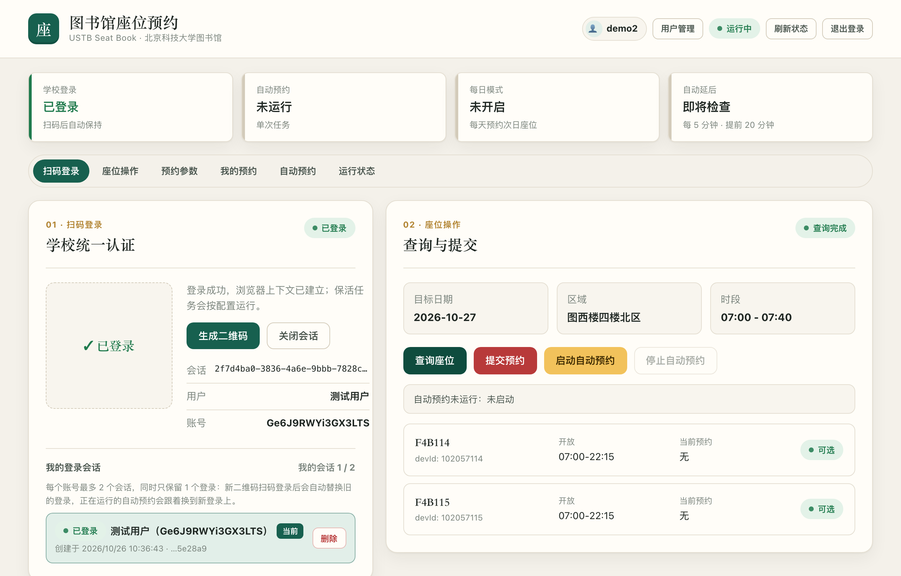
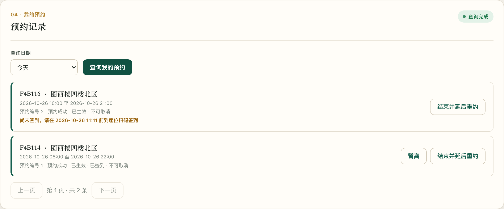
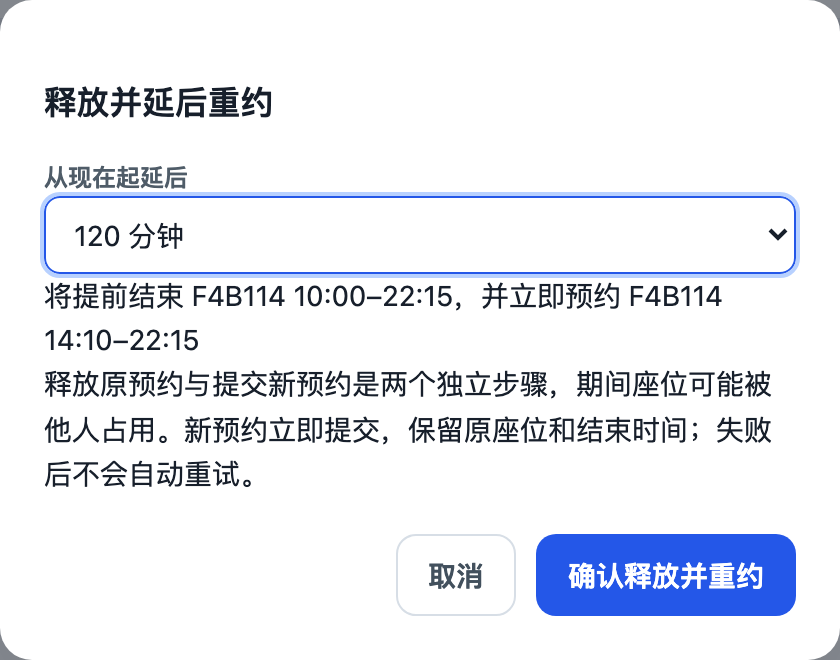

<div align="center">

# 📚 USTB Seat Book

**北京科技大学图书馆座位预约助手**

扫码登录一次，剩下的交给它：选座、定时抢座、暂离、延后重约，网页和脚本都能用。


[功能](#-功能) · [截图](#-截图) · [快速开始](#-快速开始) · [文档](#-文档) · [许可证](#-许可证)

</div>

> [!IMPORTANT]
> **每天需要重新扫码一次。** 学校统一认证和图书馆的登录不会无限期有效，保活只能尽量延长、不能保证。请每天在控制台用微信扫码刷新一次登录；开启了每日模式的账号，务必在次日触发时刻（如 05:55）之前完成扫码，否则当天的自动预约不会执行。

---

## ✨ 功能

### 🔐 登录与会话

- **微信扫码登录**学校统一认证，自动换取图书馆登录态。
- **保活**：定时检查学校与图书馆登录是否仍有效，图书馆临时不可用时自动重新获取。
- 每个账号最多 2 个会话、同时只保留 1 个登录；未扫码的二维码 5 分钟后自动回收。

### 🪑 选座与预约

- **楼层地图选座**：按真实座位坐标显示空闲 / 已占用 / 不开放 / 带电座位，点选即可加入候选。
- **时间选择与官方一致**：按座位实时规则（07:00–22:15、每 5 分钟、最短 30 分钟）给出开始 / 结束时间；预约今天时自动去掉已经过去的时间。
- **指定座位预约**：支持先 `dry_run` 预演，再确认提交。

### ⏰ 自动预约

- **每日模式**：每天在设定时刻（如 05:55）自动预约次日座位，成功后自动安排下一天。
- **候选座位逐个尝试**：第一个座位被占就换下一个；开放预约前不会乱换座、不会刷请求。
- **防重复预约**：提交请求没收到回应时，先查询“我的预约”确认，不会约到第二个座位。
- 图书馆系统未开放或临时故障时，按间隔自动重试直到成功。

### 📋 我的预约

| 操作 | 说明 |
| --- | --- |
| **查看** | 今天 / 明天的预约，显示中文状态、签到截止时间提醒 |
| **取消** | 取消尚未开始的预约 |
| **暂离** | 已签到的预约一键暂离，显示返回截止时间 |
| **延后重约** | 取消（或提前结束）当前预约，并**立即**预约同一座位 *N* 分钟后到原结束时间的新时段，先预览、再确认 |
| **自动延后** | 开启后定时检查：还没签到且快到签到截止、或暂离快到返回截止（默认不足 20 分钟）时，自动延后重约 20 分钟，避免违约 |

> 签到需要本人到座位扫码完成，本项目不提供远程签到，只做提醒。

### 👥 多用户与管理

- 任何人可自助注册，每个账号的参数、会话、任务和历史记录互相隔离。
- 管理员页面：查看所有用户、修改参数、停止任务、重置密码、管理角色和删除账号。

### 🧩 脚本 API

- 所有网页功能都有对应的 HTTP 接口，支持 **HTTP Basic**（`curl -u 用户名:密码`），不需要 Cookie。
- 一个 `/api/overview` 看全部状态；预约结果监控接口方便接入通知程序。
- 在线交互文档：`/docs`（OpenAPI）。完整说明见 [API 文档](docs/API.md)。
- **可接入 QQ、微信等机器人做提醒**：约到座位、需要重新扫码、预约失败时推送通知，见下方[机器人提醒](#-接入-qq--微信机器人提醒)。

### 🛠 运维

- 所有登录共享一个无界面 Chromium，每次登录只开一个轻量上下文。
- 浏览器健康检查（`/healthz`）、内存使用日志、运行日志轮转。
- Docker 部署；附带模拟图书馆和 QA 服务，不碰真实系统也能端到端测试。

## 📸 截图

<table>
  <tr>
    <td colspan="2"></td>
  </tr>
  <tr>
    <td width="58%"></td>
    <td width="42%"></td>
  </tr>
</table>

<sub>截图来自内置的模拟图书馆环境，账号与数据均为演示数据。</sub>

## 🚀 快速开始

需要 **Python 3.11+**。

```bash
python3.12 -m venv .venv
.venv/bin/pip install -r requirements.txt
.venv/bin/python -m playwright install chromium
cp config.example.json config.json      # 仅首次安装
.venv/bin/uvicorn app.main:app --host 0.0.0.0 --port 8000
```

打开 `http://127.0.0.1:8000`，然后按下面的顺序操作：

1. **注册账号**：第一个注册的账号自动成为管理员。
2. **生成二维码，用微信扫码登录**。
3. **设置参数**：选区域、点选座位、设时间，开启「允许预约提交」后保存。
4. **开始预约**：可以手动提交，也可以开启每日模式。
5. **每天扫码一次**：登录过期后自动预约无法执行，每天刷新一次扫码登录。

用脚本调用，例如：

```bash
curl -u 'APP_USERNAME:APP_PASSWORD' http://127.0.0.1:8000/api/overview
```

<details>
<summary><b>🐳 使用 Docker</b></summary>

```bash
docker build -t ustb-seat-book .
docker run -d --name ustb-seat-book -p 8000:8000 --shm-size 256m \
  -v "$PWD/config.json:/app/config.json" -v "$PWD/logs:/app/logs" \
  ustb-seat-book
```

生产部署（资源限制、备份、升级与回滚）见 [部署说明](deployment/DEPLOYMENT.md)。

</details>

<details>
<summary><b>🧪 运行测试</b></summary>

```bash
.venv/bin/python -m unittest discover -s tests                     # 单元与接口测试
RUN_BROWSER_TESTS=1 .venv/bin/python -m unittest discover -s tests # 含浏览器测试
.venv/bin/python -m tests.support.qa_server --port 8130             # 模拟图书馆 + 应用，手动体验
```

</details>

## 🤖 接入 QQ / 微信机器人提醒

服务本身不发消息，但提供了专门给提醒程序用的查询接口：**用应用账号密码直接查询，不需要 Cookie、不需要登录**，任何能发 HTTP 请求的机器人都能接入，比如 QQ 机器人（OneBot / NapCat 等）、企业微信群机器人、Server 酱、Telegram Bot 等。

```bash
curl -H 'Content-Type: application/json' \
  -d '{"username":"APP_USERNAME","password":"APP_PASSWORD","day":"tomorrow"}' \
  http://127.0.0.1:8000/api/monitor/status
```

按返回结果决定发什么消息：

| 返回 | 含义 | 建议提醒 |
| --- | --- | --- |
| `booking_status: "booked"` | 图书馆“我的预约”里确认有有效预约 | ✅ 约到了：座位、时间（每条记录用 `event_id` 去重，只发一次） |
| `booking_status: "not_booked"` | 查询成功，确实没有预约 | ⏳ 还没约到（可在触发时刻之后再提醒） |
| `booking_status: "unknown"` + `reason: library_login_expired` / `library_login_required` | 登录失效，无法查询 | 🔑 **请重新扫码登录** |
| `automation.state: "auth_required"` / `"failed"` | 自动预约需要扫码 / 已失败 | ⚠️ 自动预约已停止 |

一个最小的轮询示例（每 60 秒查一次，把 `notify` 换成你的机器人发送函数）：

```python
import time, httpx

API = "http://127.0.0.1:8000/api/monitor/status"
AUTH = {"username": "APP_USERNAME", "password": "APP_PASSWORD", "day": "both"}
sent = set()

def notify(text: str) -> None:
    print(text)  # 换成 QQ / 企业微信 / Server 酱 等的发送接口

while True:
    data = httpx.post(API, json=AUTH, timeout=50).json()
    for day in data.get("days", {}).values():
        if day.get("reason") in ("library_login_expired", "library_login_required") and "relogin" not in sent:
            notify("🔑 图书馆登录已失效，请打开控制台重新扫码")
            sent.add("relogin")
        for record in day.get("records") or []:
            if record["booking_state"] == "booked" and record["event_id"] not in sent:
                seat = "、".join(d["name"] for d in record["devices"] if d.get("name"))
                notify(f"✅ 已约到 {seat}：{record['begin_time'][:16].replace('T', ' ')} – {record['end_time'][11:16]}")
                sent.add(record["event_id"])
    task = data.get("automation") or {}
    if task.get("state") in ("auth_required", "failed") and task.get("state") not in sent:
        notify(f"⚠️ 自动预约已停止：{task.get('state')}")
        sent.add(task.get("state"))
    time.sleep(60)
```

> 同一来源 IP 每分钟最多 30 次认证，轮询间隔建议 60 秒。字段的完整说明和判断规则见 [提醒接入文档](deployment/MONITORING.md)。

## 📖 文档

| 文档 | 内容 |
| --- | --- |
| [使用指南](docs/GUIDE.md) | 登录流程、浏览器资源、预约与自动任务的详细行为 |
| [API 文档](docs/API.md) | 全部接口、参数、状态码、`curl` 示例、图书馆真实数据格式 |
| [配置参考](docs/CONFIGURATION.md) | 部署级与账号级参数、默认值 |
| [部署说明](deployment/DEPLOYMENT.md) | Docker / Compose 部署、备份、升级、回滚 |
| [提醒接入](deployment/MONITORING.md) | 用账号密码查询预约结果、通知去重 |
| [健康检查](deployment/HEALTH.md) | 浏览器探测与内存保护 |

## ⚠️ 使用须知

- 本项目是个人开发的辅助工具，**与北京科技大学及图书馆官方无关**。请遵守图书馆的预约、签到与暂离规定。
- 默认只查询不提交：开启「允许预约提交」并明确确认后才会真正预约。
- 不要高频并发提交；请妥善保管应用密码，不要把 `config.json`、`logs/` 等提交到仓库。
- **每天需要扫码刷新一次登录**；服务重启后也需要重新扫码。开启了每日模式的账号要在下次触发前完成扫码。

## ⚖️ 免责声明

- 本项目仅供个人学习与研究使用，按“现状”提供，**不对任何结果作出保证**，包括但不限于预约成功、登录保持、数据准确或服务持续可用。
- 图书馆与学校系统可能随时调整接口或规则，导致功能失效或行为异常；由此产生的预约失败、违约记录、账号受限等后果由使用者自行承担。
- 使用者应自行确认使用方式符合学校及图书馆的相关规定，并对自己账号下的全部操作负责。作者不对任何直接或间接损失承担责任。
- 本项目不收集、不上传任何用户数据；部署者需自行负责其服务器、账号密码与日志的安全。

## 📄 许可证

本项目采用 [PolyForm Noncommercial License 1.0.0](LICENSE.md)。

- ✅ 个人学习、研究、非营利组织**免费使用和修改**。
- ❌ **禁止任何商业用途**，包括付费代约、收费托管或用于商业产品。

